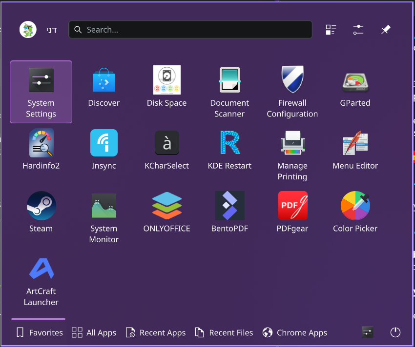

# Slim Launcher

A slimmer application launcher for **KDE Plasma 6**, forked from Plasma's standard
launcher (Kickoff, Plasma 6.8.2).



## Features

- **No category sidebar.** The app grid uses the full width of the popup.
- **Tabs at the bottom:** Favorites, All Apps, Recent Apps, Recent Files, and one
  menu category of your choice (default: *Chrome Apps*). Each extra tab can be
  switched off.
- **Grid/list button** in the header. Each tab remembers its own choice.
- **System Settings button** and a **power menu** (choose which actions it shows:
  Lock Screen, Log Out, Switch User, Sleep, Hibernate, Restart, Shut Down).
- **Gap from the panel**, so the popup keeps its full frame next to a non-floating panel.
- Tab labels as *icon and text*, *text under icon* or *icons only*.
- Resizable down to two rows of icons; Plasma remembers the size.

## Requirements

- KDE Plasma 6.8 (developed and tested on 6.8.2, Arch Linux, Wayland)

The launcher uses Plasma's internal `org.kde.plasma.private.kicker` module, as the
original Kickoff does. A future Plasma release may change that module and need an
update of this widget.

## Install

From Plasma: right-click the panel → **Add Widgets…** → **Get New Widgets…** →
search for *Slim Launcher*.

From a release file:

```bash
kpackagetool6 -t Plasma/Applet -i slim-launcher-<version>.plasmoid
```

From source:

```bash
git clone https://github.com/kkuikku/slim-launcher.git
cd slim-launcher
./scripts/install.sh
```

Then right-click the panel → **Add Widgets…** → **Slim Launcher**.

Update an installed copy:

```bash
./scripts/install.sh            # installs or upgrades
systemctl --user restart plasma-plasmashell.service
```

Remove:

```bash
kpackagetool6 -t Plasma/Applet -r io.github.kkuikku.slimlauncher
```

## Development

| Script | What it does |
|---|---|
| `scripts/build.sh` | Builds `dist/slim-launcher-<version>.plasmoid` |
| `scripts/install.sh` | Installs or upgrades the widget from `package/` |
| `scripts/test.sh` | Lints all QML against the installed Qt/Plasma modules, opens the widget in `plasmoidviewer`, saves the log and a screenshot to `test-output/` |

## License

GPL-2.0-or-later (some files LGPL-2.0-or-later, as marked in their headers).
Based on Kickoff by Martin Graesslin, Mikel Johnson and the KDE community.
Full texts in [`LICENSES/`](LICENSES/).
